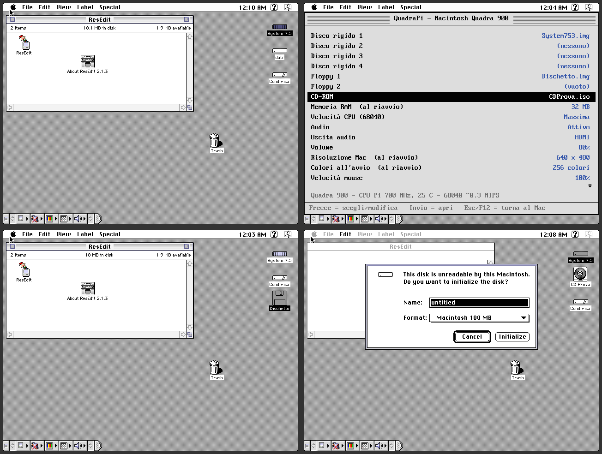

# QuadraPi: Macintosh Quadra 900 bare metal per Raspberry Pi 4

QuadraPi trasforma un Raspberry Pi 4 (o Pi 400) in un **Macintosh Quadra 900**
(68040 con FPU). Non c'è Linux: il Pi si avvia direttamente nel Mac.

Il motore di emulazione è [Basilisk II](https://github.com/kanjitalk755/macemu),
portato sulla libreria bare metal [Circle](https://github.com/rsta2/circle)
tramite [circle-stdlib](https://github.com/smuehlst/circle-stdlib).



## Funzioni

Il menu si apre con **F12** e mette in pausa l'emulazione:

| Voce | Effetto |
|---|---|
| Disco rigido 1-4 | immagini dei dischi rigidi, con creazione di immagini vuote da 20 MB a 2 GB (al riavvio) |
| Floppy 1-2, CD-ROM | inserimento immediato di immagini, con il Mac acceso |
| Memoria RAM | da 8 a 512 MB (al riavvio) |
| Velocità CPU | 25 MHz (originale), 33, 40, 50, 66, 100 MHz o Massima (subito) |
| Audio | acceso o spento, uscita HDMI o jack da 3,5 mm, volume |
| Risoluzione / colori | da 512x384 a 1600x1200, da 1 a 32 bit |
| Altro | velocità del mouse, tasto Alt = Comando/Opzione, data e ora, azzeramento PRAM |

Inoltre:
- la cartella `quadra/shared` della SD compare sul Mac come disco **"Condivisa"**;
- data e ora vengono salvate sulla SD, perché il Pi non ha un orologio;
- il browser dei file vede anche una chiavetta USB.

## Uso rapido

1. Formatta una microSD in **FAT32**.
2. Copia il contenuto della cartella [`sdcard/`](sdcard/) nella radice della SD.
3. Aggiungi il firmware del Pi 4 dal repository
   [raspberrypi/firmware](https://github.com/raspberrypi/firmware/tree/master/boot):
   `start4.elf`, `fixup4.dat`, `bcm2711-rpi-4-b.dtb` (`bcm2711-rpi-400.dtb` per il Pi 400).
4. Aggiungi `armstub8-rpi4.bin`, che si compila da `circle/boot` con `make armstub64`.
5. Copia la **ROM** del tuo Mac in `quadra/` (es. `quadra/Quad900.ROM`).
   La ROM è di Apple e **non è inclusa**: va estratta da una macchina di tua proprietà.
6. Metti un'immagine disco con System 7.x / Mac OS 8.1 in `quadra/hd`, poi premi
   F12 → *Disco rigido 1* → *Applica e riavvia*.

La guida completa in italiano è in [`sdcard/LEGGIMI.txt`](sdcard/LEGGIMI.txt).

## Compilazione

Le istruzioni sono in [`docs/COMPILARE.txt`](docs/COMPILARE.txt). In breve:

```sh
# circle-stdlib con FatFs fast seek abilitato
./configure -r 4 -p aarch64-none-elf- --kernel-max-size 32 \
    -o ARM_ALLOW_MULTI_CORE -o KERNEL_STACK_SIZE=0x100000 && make
# QuadraPi
make STDLIBHOME=/percorso/di/circle-stdlib     # -> kernel8-rpi4.img
```

Per le prove senza hardware c'è una variante per il Pi 3, che gira in QEMU
`raspi3b`: vedi `tools/build-pi3.sh` e `tools/run.sh`.

## Struttura

```
src/        piattaforma QuadraPi: kernel Circle, video (core 1), audio,
            tastiera e mouse USB -> ADB, immagini disco con cache, menu F12,
            orologio, preferenze
basilisk/   nucleo di Basilisk II, con piccole modifiche (vedi docs/COMPILARE.txt)
sdcard/     file da copiare sulla SD: kernel compilato, config.txt,
            cartella quadra/ e guida
tools/      script per le prove in QEMU
```

## Stato

- **Provato in QEMU** (variante Pi 3): avvio di System 7.5.3, tastiera, mouse,
  menu, floppy e CD a caldo, creazione e inizializzazione di dischi,
  cambio della RAM con riavvio, spegnimento.
- **Da provare su un Raspberry Pi 4 vero**: USB (xHCI), audio HDMI e jack,
  velocità reale.
- **Limiti**: emulazione di alto livello (niente rete, seriali, SCSI reale);
  il 68040 è interpretato, senza JIT.

## Licenza

GNU GPL v3 (vedi [LICENSE](LICENSE)). Contiene Basilisk II
(© Christian Bauer e altri, GPL v2 o successiva, vedi `basilisk/COPYING`)
e si collega a Circle (GPL v3).
